# Hollow: Cook Off — 기술 문서

[← README로 돌아가기](../README.ko.md)

## 목차

1. [개요](#1-개요)
2. [확장 구조](#2-확장-구조)
3. [적 AI](#3-적-ai)
4. [체력 · 아머 · 보스 페이즈](#4-체력--아머--보스-페이즈)
5. [플레이어 전투 시스템](#5-플레이어-전투-시스템)
6. [레벨 기믹](#6-레벨-기믹)
7. [대화 시스템](#7-대화-시스템)
8. [일시정지 · 저장 · 점수](#8-일시정지--저장--점수)
9. [밸런스 데이터 연동](#9-밸런스-데이터-연동)
10. [한계와 개선 방향](#10-한계와-개선-방향)

---

## 1. 개요

- 2D 액션 사이드 슈팅 게임. 2024년 Steam 출시
- **Corgi Engine**(2D 플랫포머 엔진) 위에서 개발했습니다. 이동·충돌·AI 상태 머신·무기의 기본 골격은 엔진이 제공하고, 이 저장소의 코드는 그 위에 게임 고유의 규칙을 얹은 부분입니다.
- 엔진 소스와 서드파티 라이브러리는 포함하지 않았습니다.

| 영역 | 주요 파일 |
|---|---|
| 적 AI | `Enemy/Action/*`, `Enemy/Decision/*`, `Enemy/AIBrain_ArmorFind.cs` |
| 적 무기 | `Enemy/Weapon/*`, `CirSectorAttack.cs` |
| 체력·보스 | `HealthExpend.cs`, `UI/BossHealthDisplay.cs`, `UI/ArmorHealthDisplay.cs` |
| 플레이어 전투 | `UI/Weapons/MeleeWeapon.cs`, `UI/Weapons/DamageOnTouch_Knife.cs`, `BulletParry.cs`, `SlashCombo.cs`, `BioEnerge.cs`, `SpecialAbility.cs`, `UI/Weapons/Grappling*.cs`, `UI/Weapons/SubWeapon.cs`, `UI/Weapons/Pause*.cs` |
| 레벨 기믹 | `Enemy/Level/*`, `JsonCogi/CamLock.cs` |
| 대화 | `ChatDB.cs`, `ChatEventTrigger.cs`, `UI/Chat/*` |
| 시스템 | `PauseManager.cs`, `SaveDataManager.cs`, `JsonCogi/ScoreManager.cs`, `GSManager.cs` |

---

## 2. 확장 구조

엔진 코드를 직접 고치는 대신 **엔진 클래스를 상속해 확장**하는 방식을 기본으로 했습니다.

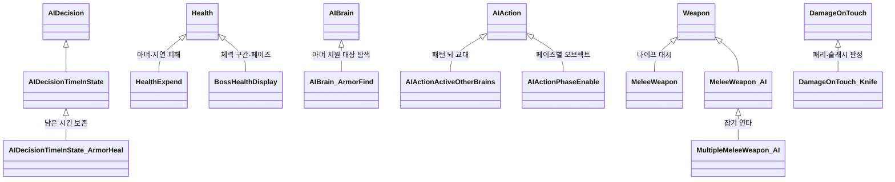

- 엔진의 `[AddComponentMenu]` 규칙을 따라 커스텀 액션·결정도 엔진 것과 같은 메뉴에서 붙일 수 있게 했습니다.
- 엔진의 이벤트(`MMDamageTakenEvent`, `MMCameraEvent`)와 피드백(`MMFeedbacks`)을 그대로 써서, 연출을 코드 수정 없이 인스펙터에서 바꿀 수 있습니다.

---

## 3. 적 AI

### 3.1 엔진의 AI 구조

Corgi Engine의 `AIBrain`은 **상태 = 액션 목록 + 전이 목록**으로 구성됩니다.

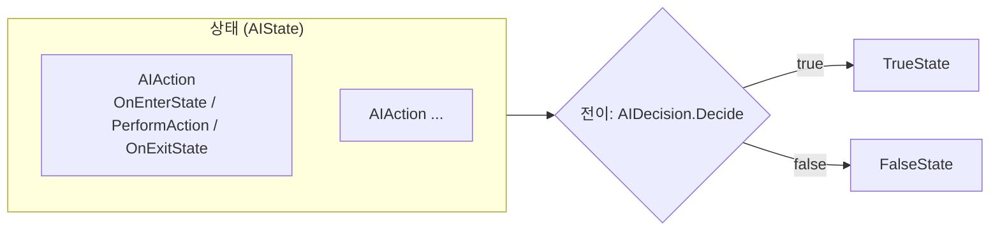

- 행동은 `AIAction`, 전이 조건은 `AIDecision` 컴포넌트로 만들고, 상태는 이들을 조합해 인스펙터에서 구성합니다.
- 일반 적과 보스의 패턴은 이 구조 위에 **커스텀 액션·결정**을 추가해 만들었습니다.

### 3.2 커스텀 액션 · 결정

| 클래스 | 역할 |
|---|---|
| `AIActionActiveOtherBrains` | 여러 패턴 뇌 중 하나를 골라 활성화 (3.3) |
| `AIActionPhaseEnable` | 현재 보스 페이즈에 맞는 오브젝트 묶음을 무작위로 활성화 |
| `AIActionMoveTowardsTarget_Point` | 지정 지점들 사이를 걷거나 스윙하며 이동 |
| `AIActionSpawn` | 오브젝트 소환. 소환 위치까지 보간 이동 옵션 |
| `AIActionEnableObject` | 상태 진입 시 오브젝트 활성화, 애니메이션 종료 대기 옵션 |
| `AIActionChangeTargetEvent` | 상태 진입·종료 시 타깃 변경/복원 |
| `AIActionHeal` | 대상 체력 회복 (선형 / 일정 간격 버스트) |
| `AIDecisionTimeInState_ArmorHeal` | 아머 회복 대기 시간. 중간에 끊기면 **남은 시간을 보존** (3.4) |
| `AIDecisionTimeInState_TargetHold` | 타깃 유지 시간 판정 |

> 📷 **[S06]** 적의 AIBrain 인스펙터 — 상태별 액션과 전이(결정)가 구성된 모습
>
> 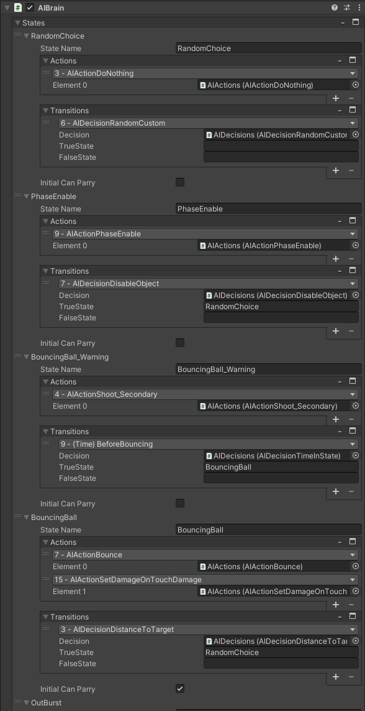

### 3.3 보스 패턴 교대 (`AIActionActiveOtherBrains`)

보스 하나에 패턴별 `AIBrain`을 여러 개 두고, 상위 뇌가 하나씩 골라 켭니다.

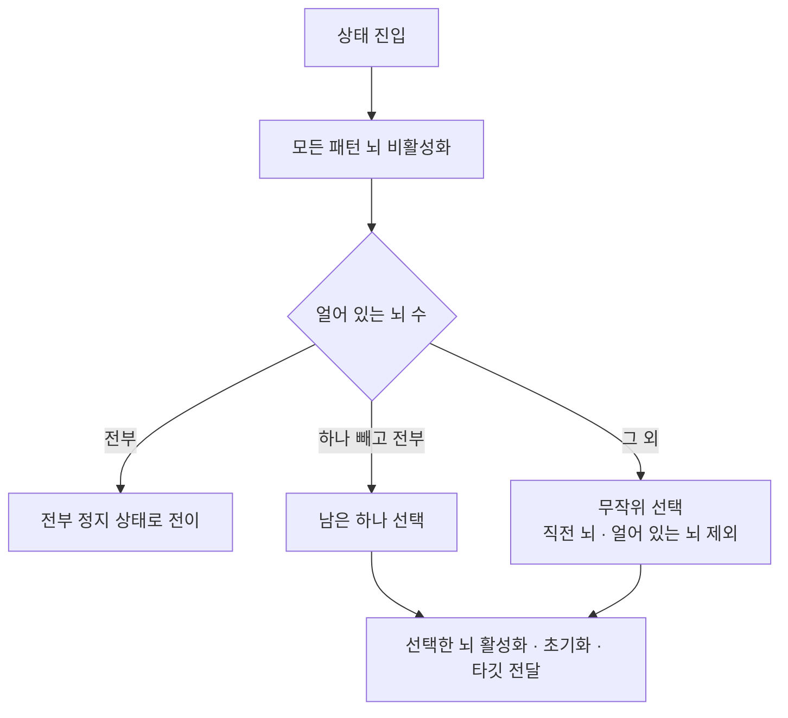

- **직전 패턴 반복 방지**: 바로 전에 쓴 뇌는 다시 고르지 않습니다.
- **정지된 패턴 제외**: 시간 정지 등으로 `Freeze` 상태인 뇌는 건너뛰고, 전부 정지되면 별도 상태로 넘어갑니다. 정지가 풀리면 `TryUnfreezeBrain`으로 다시 교대를 시작합니다.
- **패턴 파괴 대응**: 부위가 파괴돼 뇌가 사라지면 목록에서 제거하고, 현재 뇌였다면 교체 이벤트를, 목록이 비면 종료 이벤트를 호출합니다.

### 3.4 아머 지원형 적 (`AIBrain_ArmorFind`)

아군의 아머를 회복시켜 주는 적입니다.

1. 씬에서 **아머가 깎인 아군 중 가장 가까운 대상**을 찾습니다.
2. 대상이 있으면 `DrawLine`으로 연결선을 표시해 플레이어가 지원 관계를 볼 수 있게 합니다.
3. 대상이 없으면 플레이어를 타깃으로 바꾸고 추적 상태로 전이합니다.
4. `AIDecisionTimeInState_ArmorHeal`이 회복 대기 시간을 판정합니다. 플레이어 공격 등으로 상태가 중간에 끊기면 남은 시간을 저장했다가, 다음 진입 때 이어서 셉니다. 매번 처음부터 다시 세면 회복이 영영 안 되거나 너무 쉽게 끊기기 때문입니다.

> 📷 **[S07]** 아머 지원형 적이 아군과 연결선을 그리며 아머를 회복시키는 장면
>
> 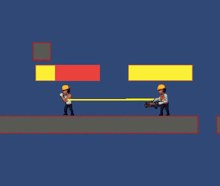

### 3.5 적 무기

| 클래스 | 동작 |
|---|---|
| `MeleeWeapon_AI` | 피해 영역(사각형/원)을 지연 후 일정 시간 활성화. 공격 예비 동작 동안 **패리 가능 창**을 열고 닫음 |
| `MultipleMeleeWeapon_AI` | 첫 타격에 성공하면 플레이어를 붙잡아 위치를 고정하고, 정해진 횟수만큼 연타 후 넉백으로 풀어줌. 마지막 타는 무적 시간을 다르게 적용 |
| `AIGrenade` | 대상까지 애니메이션 커브로 높이를 주는 포물선 비행 후 폭발. 대상의 무적을 무시하는 옵션 |
| `Boomerang` | 최대 거리 비율에 따라 감속하며 날아갔다가 되돌아오면 비활성화 |
| `CirSectorAttack` | 부채꼴 범위 판정, 디버그 기즈모 |

---

## 4. 체력 · 아머 · 보스 페이즈

### 4.1 `HealthExpend`: 아머가 있는 체력

엔진의 `Health`를 상속해 일반 적의 피해 규칙을 확장했습니다.

| 기능 | 내용 |
|---|---|
| 아머 우선 흡수 | 피해를 아머가 먼저 받고, 넘친 만큼만 체력에서 깎음 |
| 아머 파괴 반응 | 아머가 깨지는 순간 피드백 재생 + 선택적으로 **뇌 교체**, 하수인 소환, 지정 능력 비활성화 |
| 정지 중 피해 지연 | 시간 정지로 멈춘 동안 받은 피해를 큐에 쌓았다가, 정지가 풀리면 한 프레임에 하나씩 적용. 누적 피해가 남은 체력을 넘으면 미리 충돌 레이어를 바꿔 "이미 죽은" 적이 더 맞지 않게 함 |
| 탄 회피 | 회피형 적은 일반 탄을 맞지 않고 회피 동작 (패리된 탄은 예외) |
| 등 뒤 전용 | 특정 적은 정면 공격을 무시 |
| 별도 코어 | 특수 공격이 들어오면 연결된 코어 체력에도 피해 전달 |
| 데이터 동기화 | 시작 시 AI 타입 이름으로 밸런스 시트(9장)에서 체력·아머를 찾아 적용 |

```csharp
if (currentArmor > 0)
{
    if (currentArmor > damage) { currentArmor -= damage; damage = 0; }
    else
    {
        damage -= currentArmor;
        currentArmor = 0;
        armorBreakFeedback?.PlayFeedbacks();
        if (armorBreakAction)
        {
            swapBrain?.PerformAction();            // 아머가 깨지면 행동 패턴 교체
            ...
        }
    }
}
```

### 4.2 `BossHealthDisplay`: 체력 구간과 슬래시 페이즈

보스 체력은 여러 구간으로 나뉩니다. 한 구간을 다 깎으면 바로 다음 구간으로 넘어가지 않고 **블록(기절)** 상태가 되며, 플레이어가 나이프 슬래시로 블록을 깨야 다음 페이즈로 갑니다.

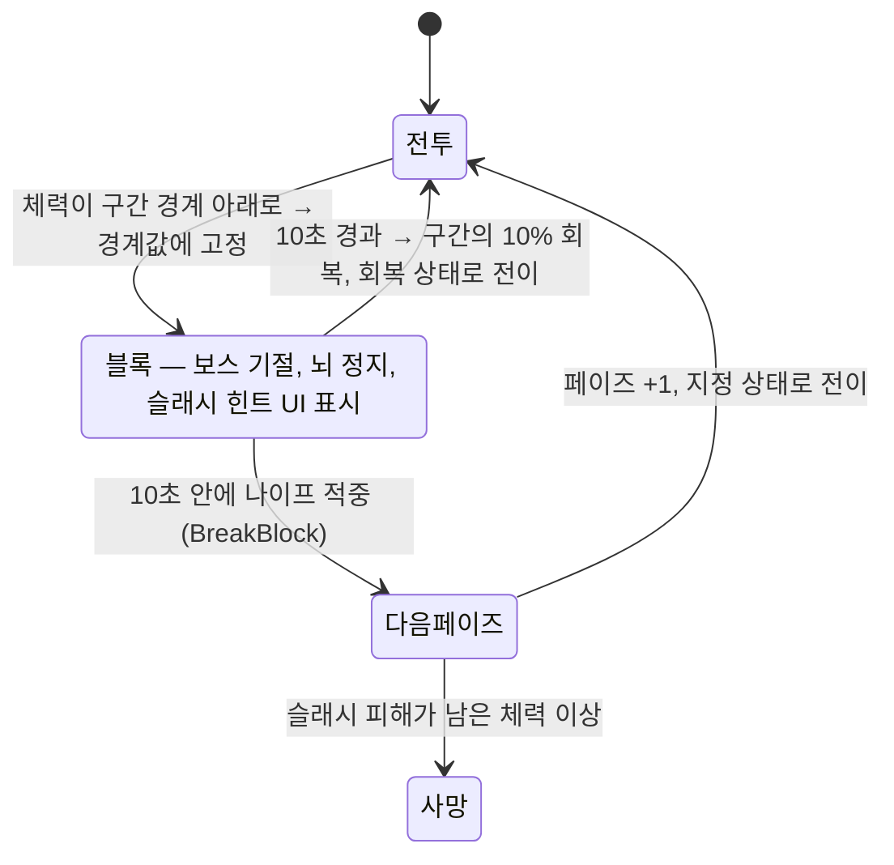

- **체력 고정**: 체력 setter에서 구간 경계 아래로 내려가면 경계값으로 고정하고 블록을 시작합니다. 강한 공격 한 번으로 구간을 건너뛰지 못합니다.
- **대기 후 블록**: 특정 공격 상태 도중이면 그 상태가 끝날 때까지 기다렸다가 블록에 들어갑니다. 공격 모션이 어색하게 끊기지 않습니다.
- **페이즈 연동**: 페이즈가 오르면 `AIActionPhaseEnable`이 해당 페이즈의 오브젝트 묶음을 쓰고, 페이즈별 대화(7장)도 트리거됩니다.
- **블록 해제 조건**: `DamageOnTouch_Knife`가 보스에 적중할 때 `BreakBlock`을 호출합니다. 성공하면 슬래시 연출과 BE 회복(5.4)이 따라옵니다.

> 📷 **[S01]** 보스 블록 상태 — 슬래시 힌트 UI가 표시된 화면
>
> 

---

## 5. 플레이어 전투 시스템

### 5.1 나이프 대시 슬래시 (`MeleeWeapon` + `DamageOnTouch_Knife`)

나이프는 휘두르는 무기가 아니라 **조준 방향으로 돌진하며 베는** 무기입니다.

- **벽 거리 제한**: 돌진 전에 조준 방향으로 레이캐스트해 벽까지 거리를 구하고, 그만큼만 이동합니다.
- **남은 거리 비례 넉백**: 넉백 세기를 `남은 돌진 거리`에 비례시켜, 가까이서 맞힐수록 멀리 밀려납니다.
- **차지**: 버튼을 일정 시간 이상 누르면 위로 띄우는 넉백(에어본)으로 바뀝니다.
- **넉백 벽 끼임 보정**: 넉백은 DOTween으로 이동시키되, 매 프레임 진행 방향으로 레이캐스트해 벽에 닿으면 즉시 멈추고 위치를 보정합니다. 이동이 끝난 뒤 화면 밖이면 한 번 더 보정합니다.
- **연속 공격**: 적을 처치하거나 블록을 깨면 쿨다운이 0이 되고 콤보가 올라가 바로 다시 돌진할 수 있습니다.

### 5.2 두 가지 패리

| 종류 | 조건 | 결과 |
|---|---|---|
| 근접 패리 | 적 상태의 **패리 가능 창**이 열려 있을 때 나이프 적중 | 적 패리 기절, 창 닫힘, 플레이어 체력 일부 회복 |
| 탄환 패리 | 나이프가 패리 가능한 탄(전용 레이어)에 적중 | 탄을 되받아치기 (아래) |

**탄환 패리 흐름** (`BulletParry`)

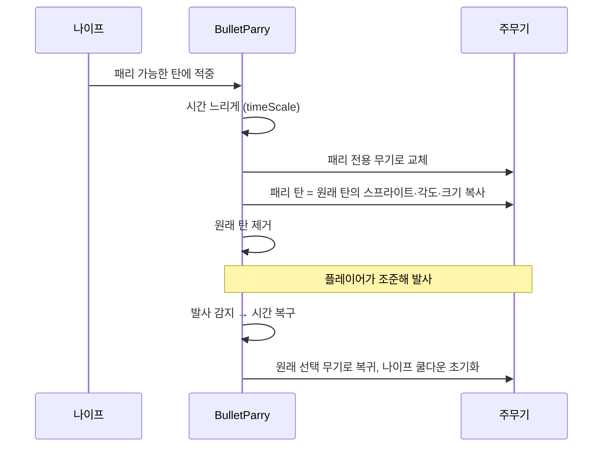

받아친 탄이 원래 탄과 똑같이 보이도록 외형을 복사해, "내가 그 탄을 되돌려 쐈다"는 느낌을 줍니다.

> 📷 **[S02]** 탄환 패리 순간 — 시간이 느려지고 받아칠 방향을 조준하는 화면
>
> 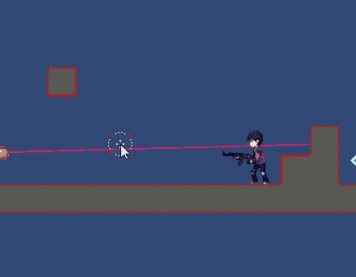

### 5.3 특수 능력 (`SpecialAbility`)

장착한 주무기 종류에 따라 같은 입력(좌·우 클릭 동시)이 다른 능력이 됩니다.

| 무기 | 능력 | 동작 |
|---|---|---|
| 리볼버 | Panning | 제자리에 멈춰 일정 간격으로 5연사. 피격되면 즉시 취소 |
| 머신건 | Pirouette | 지상에서 회전 사격하며 게이지 상승, 공중에서는 중력을 1/5로 줄여 체공. 게이지가 한계를 넘으면 강제 종료 후 기절 |

### 5.4 BE(Bio Energy) 자원 (`BioEnerge`)

| 사용 | 비용 | 효과 |
|---|---|---|
| 회복 | 100 | 체력 100 회복 |
| BE 폭발 | 100 | 주변 적을 띄우는 범위 공격 (해금 콘텐츠, 쿨타임) |

**충전 경로**: 나이프로 적의 아머를 깨뜨리면 `30 + 슬래시 콤보 × 15`, 보스 블록 파괴나 특수(Bio) 대상이면 최대치의 1/3을 회복합니다. 공격적인 플레이(슬래시 연계)가 곧 회복 수단이 되도록 순환을 설계했습니다.

### 5.5 갈고리 (`GrapplingGun` + `GrapplingRope`)

- 마우스 방향으로 레이캐스트해 맞은 지점에 줄을 겁니다. **카메라 밖 지점에는 걸리지 않게** 막아, 화면 밖 지형에 매달리는 것을 방지합니다.
- **지형**: 스프링·거리 조인트로 스윙. 착지하거나 발사 지점을 지나치면 자동 해제합니다.
- **적**: 적에게 걸면 플레이어를 고정하고 적을 플레이어 쪽으로 끌어옵니다.
- **로프 연출**: 발사 직후에는 사인파로 출렁이다가 점점 직선으로 펴지는 줄을 LineRenderer로 그립니다.

> 📷 **[S03]** 갈고리로 적을 끌어오는 장면 (또는 지형 스윙)
>
> 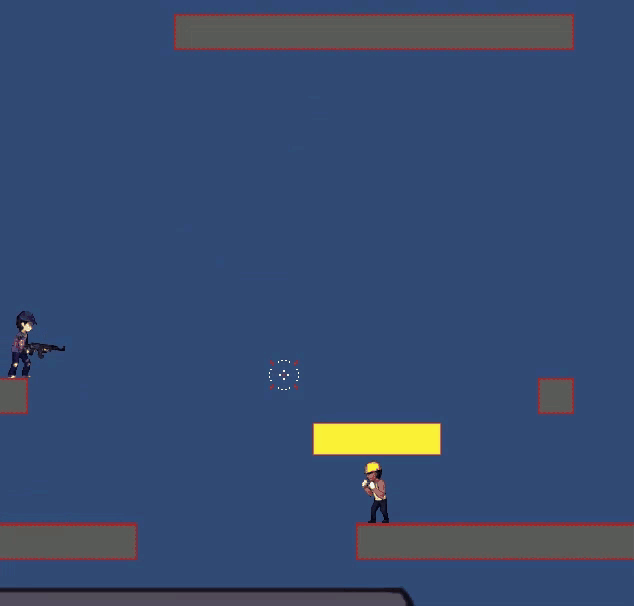

### 5.6 보조 무기 · 시간 정지

- **보조 무기** (`SubWeapon`): 자극제(Stim), 망토(Cloak — 피해를 대신 받는 내구도, 재생 대기), 수류탄, 갈고리. 수치는 밸런스 시트에서 읽습니다.
- **시간 정지 영역** (`PauseArea`): 영역 안의 캐릭터를 얼리고, 투사체 속도를 0으로, 이동 플랫폼과 회전 오브젝트를 멈춥니다. 끝나면 대상별로 원래 상태를 되돌립니다. 보스는 짧게만 멈춥니다.

---

## 6. 레벨 기믹

| 기믹 | 동작 |
|---|---|
| 전기벽 (`ElectricWall`, `ElectricWallManager`) | 길이·속도·방향·수명을 런타임에 설정하는 전기벽. 매니저가 풀링으로 관리 |
| 프레서 (`Presser`) | 경고등 깜빡임 → 내려찍으며 피해 → 원위치 → 대기를 반복 |
| 컨베이어 (`ConveyorBelt`) | 닿아 있는 물체를 벨트 방향으로 이동 |
| 이동 플랫폼 (`CustomMovingPlatform`) | 엔진 이동 플랫폼 확장. 깜빡이며 사라지는 옵션 |
| 늘어나는 막대 (`StratchableStick`) | 대상까지 길이와 콜라이더 크기를 맞춰 늘어남 |
| 전투 구역 (`CamLock`) | 진입 시 카메라를 구역에 고정하고 임시 체크포인트 설정 후 페이지(웨이브) 단위로 적 소환. 모두 처치하면 해제, 도중에 사망하면 소환 초기화 |

> 📷 **[S04]** 전기벽·프레서 등 레벨 기믹이 보이는 스테이지 화면
>
> 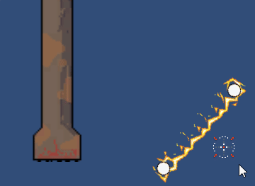

---

## 7. 대화 시스템

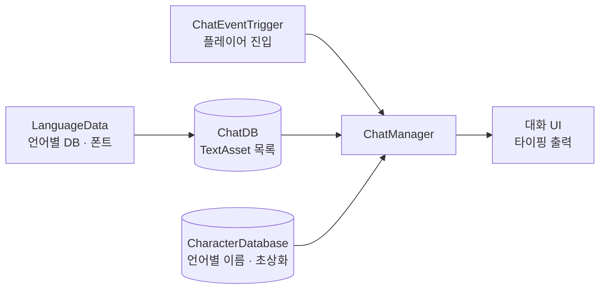

- **데이터**: `ChatDB`(ScriptableObject)가 대화별 텍스트 파일을 들고 있습니다. 한 줄이 한 대사이고, `화자ID<TAB>내용` 형식입니다. 대사를 고칠 때 코드나 씬을 건드리지 않습니다.
- **화자 표시**: 화자 ID로 `CharacterDatabase`에서 현재 언어의 이름과 초상화를 찾습니다. 없는 ID면 그대로 이름으로 표시합니다.
- **다국어**: `LanguageData`를 바꾸면 대화 DB와 폰트가 함께 바뀝니다 (한국어 / 영어).
- **대화 중 이벤트**: `WhileChatEvent`로 "N번째 대사에서 이 이벤트 실행"을 인스펙터에서 지정합니다. 대사에 맞춰 연출을 붙일 수 있습니다.
- **진행 제어**: 대화가 시작되면 플레이어 조작을 막고, 지정한 캔버스를 뺀 나머지 UI를 숨기고, 일시정지를 요청합니다(8장). 끝나면 종료 이벤트를 호출합니다.
- **트리거**: `ChatEventTrigger`는 플레이어 진입 시 한 번만 발동하고, 시작 지연·진입 이벤트·대화 종료 후 이벤트를 따로 지정할 수 있습니다.

> 📷 **[S05]** 대화 UI — 초상화, 화자 이름, 대사가 표시된 장면
>
> 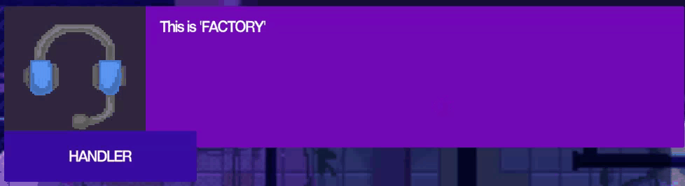

---

## 8. 일시정지 · 저장 · 점수

### 8.1 일시정지 요청 집계 (`PauseManager`)

메뉴·대화·무기 선택 UI·패리 연출 등 여러 시스템이 각자 시간을 멈추려 합니다. 하나가 풀었다고 다른 시스템의 정지까지 풀리면 안 되므로, **요청자별 상태를 모아** 판단합니다.

```csharp
public void PauseCall(object source, bool pause)
{
    pauseCalled[source] = pause;                       // 요청자별 상태 기록
    bool isPauseCalled = pauseCalled.ContainsValue(true);
    if (Time.timeScale > 0 && isPauseCalled)
        lastTimeScale = Time.timeScale;                // 슬로모션 중이었다면 그 배율 보존
    Time.timeScale = isPauseCalled ? 0 : lastTimeScale;
}
```

정지 직전의 `timeScale`을 기억해, 패리 슬로모션 도중 메뉴를 열었다 닫아도 슬로모션 배율로 정확히 돌아갑니다.

### 8.2 저장 (`SaveDataManager`)

진행 상황(무기·능력 해금 여부, 스테이지별 최고 기록, 난이도, 도달 스테이지)을 직렬화 클래스로 묶어 `JsonUtility`로 JSON 변환 후 `PlayerPrefs`에 저장합니다. 체크포인트 재시작은 `PauseManager`가 체크포인트 시점의 체력·BE로 복원합니다.

### 8.3 점수 (`ScoreManager`)

클리어 시간, 사망 수, 슬래시·패리 횟수, 공중 사격, 공중 적 처치, 노 데미지·노 힐·노 사망 보너스를 항목별로 집계해 결과 화면과 랭크에 씁니다. 슬래시·패리를 점수에 넣어, 5장의 공격적 플레이를 보상으로 연결했습니다.

---

## 9. 밸런스 데이터 연동

무기·보조 무기·액션·적 수치를 **Google 스프레드시트**로 관리하고 UnityGoogleSheet로 불러옵니다.

```csharp
UnityGoogleSheet.Load<WeaponTable.BaseData>();
UnityGoogleSheet.Load<HollowBalance.action>();      // 나이프 거리, BE 폭발 범위 등
UnityGoogleSheet.Load<SubweaponTable.Cloak>();
UnityGoogleSheet.Load<EnemyBalance.Data>();         // 적 체력·아머
...
```

- 기획자가 시트를 고치면 빌드 없이 수치가 반영됩니다.
- 적은 AI 타입 이름을 키로 체력·아머를 찾고(4.1), 플레이어 액션은 시트의 행을 읽어 나이프 거리·차지 시간·BE 폭발 범위 등을 설정합니다.

---

## 10. 한계와 개선 방향

| 항목 | 현재 | 개선 방향 |
|---|---|---|
| 시트 값 접근 | `actionList[15]`처럼 행 인덱스로 접근. 시트 행 순서가 바뀌면 다른 값을 읽음 | 키 이름으로 조회하거나 enum으로 인덱스 정의 |
| 대상 탐색 | `FindObjectsOfType(typeof(GameObject))`로 씬 전체를 순회 (아머 지원 대상 탐색) | 아머 보유 적을 등록·해제하는 목록으로 관리 |
| 하드코딩된 레이어·상태명 | 레이어 번호(13, 16, 21, 27, 29)와 상태 이름 문자열로 판정 | 레이어·상태 이름을 상수로 모으기 |
| 입력 처리 | 여러 컴포넌트가 `Input`을 직접 폴링 | 입력 계층을 분리해 리바인딩·패드 대응 |
| 파일명과 클래스명 | `ChatEventTrigger.cs` 안의 클래스명은 `ChatEventTriger` (원본 프로젝트 이름 유지) | 클래스명 통일 |
